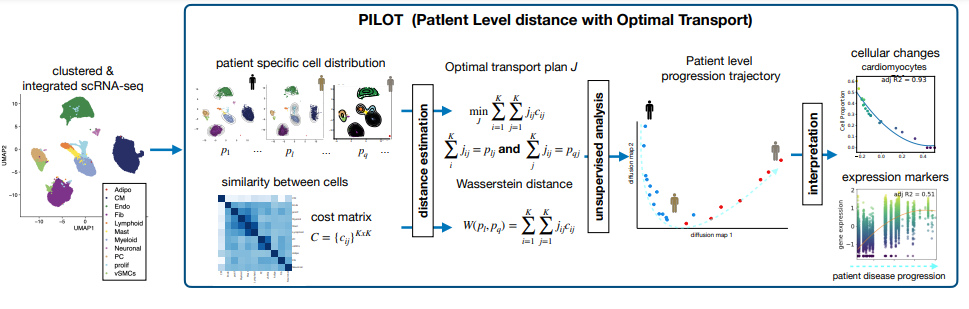

# PILOT    [[Paper](https://link.springer.com/article/10.1038/s44320-023-00003-8)]

[](https://github.com/CostaLab/PILOT?tab=MIT-1-ov-file#MIT-1-ov-file)

Although clinical applications represent the next challenge in single-cell genomics and digital pathology, we still lack computational methods to analyze single-cell or pathomics data to find sample-level trajectories or clusters associated with diseases. This remains challenging as single-cell/pathomics data are multi-scale, i.e., a sample is represented by clusters of cells/structures, and samples cannot be easily compared with each other. Here we propose PatIent Level analysis with Optimal Transport (PILOT). PILOT uses optimal transport to compute the Wasserstein distance between two individual single-cell samples. This allows us to perform unsupervised analysis at the sample level and uncover trajectories or cellular clusters associated with disease progression. We evaluate PILOT and competing approaches in single-cell genomics or pathomics studies involving various human diseases with up to 600 samples/patients and millions of cells or tissue structures. Our results demonstrate that PILOT detects disease-associated samples from large and complex single-cell or pathomics data. Moreover, PILOT provides a statistical approach to find changes in cell populations, gene expression, and tissue structures related to the trajectories or clusters supporting interpretation of predictions.



## 🆕 What's new in version 2.1.2
> [!TIP]
> - **Clinical variables, automatically (new):** test all variables of the patients against the trajectory or the patient sub-groups in one call; the types are detected and unusable columns are skipped. Sub-groups get names such as `control_1`. 👉 [Trajectory](https://pilot.readthedocs.io/en/latest/Kidney_trajectory.html) · [Sub-groups](https://pilot.readthedocs.io/en/latest/Kidney_clusters.html)
> - **Faster gene analysis (new):** `genes_importance` saves small sparse files instead of large CSV files; old results still work.
> - **MuData (new):** export and import the results with one row per patient. 👉 [Tutorial](https://pilot.readthedocs.io/en/latest/MuData.html)
> - **From raw data (new tutorial):** QC, PCA, Harmony and Leiden, then PILOT, on COVID-19 data. 👉 [Tutorial](https://pilot.readthedocs.io/en/latest/COVID_from_scratch.html)
> - **Trajectory branches (2.1.1, MI and lung cancer atlas)** 👉 [Tutorial](https://pilot.readthedocs.io/en/latest/Trajectory_branches.html) · **Distance settings (2.1.0)** 👉 [Tutorial](https://pilot.readthedocs.io/en/latest/Distance_settings.html)
>
> Default results are unchanged.

## Installation
The easiest way to install PILOT and the required packages is using the following way:

```terminal
pip install pilotpy
```
Once you've completed these steps, you can proceed to run the tutorials and explore the features of PILOT. 
When doing so, remember to move to the tutorial folder, as all the work will be performed there:

```terminal
git clone https://github.com/CostaLab/PILOT.git
cd PILOT/Tutorial
```

## [Tutorial&Data sets](https://pilot.readthedocs.io/en/latest/index.html)
- [Myocardial Infarction (single-cell data)](https://pilot.readthedocs.io/en/latest/Myocardial_infarction.html): start here
- [COVID-19 from raw data: QC to PILOT](https://pilot.readthedocs.io/en/latest/COVID_from_scratch.html)
- [Pathomics data: combination of Kidney IgAN(G) & Kidney IgAN(T)](https://pilot.readthedocs.io/en/latest/Combination_Kidney_IgAN.html)
- [Patient sub-group detection and ranking of cells/genes (Pancreas data)](https://pilot.readthedocs.io/en/latest/Patients_sub_group_detection.html)
- [Batch effects in the trajectory](https://pilot.readthedocs.io/en/latest/Kidney_trajectory.html) and [in the patient sub-groups](https://pilot.readthedocs.io/en/latest/Kidney_clusters.html)
- [Settings of the Wasserstein distance](https://pilot.readthedocs.io/en/latest/Distance_settings.html)
- [Splitting the trajectory into branches (Myocardial Infarction and lung cancer atlas)](https://pilot.readthedocs.io/en/latest/Trajectory_branches.html)
- [Export and import with MuData](https://pilot.readthedocs.io/en/latest/MuData.html)

You can access the used data sets by PILOT in Part 1 [](https://zenodo.org/records/8370081) and  Part 2 [](https://zenodo.org/records/7957118)


## Citation
```
@article{joodaki2024detection,
  title={Detection of PatIent-Level distances from single cell genomics and pathomics data with Optimal Transport (PILOT)},
  author={Joodaki, Mehdi and Shaigan, Mina and Parra, Victor and B{\"u}low, Roman D and Kuppe, Christoph and H{\"o}lscher, David L and Cheng, Mingbo and Nagai, James S and Goedertier, Micha{\"e}l and Bouteldja, Nassim and others},
  journal={Molecular systems biology},
  volume={20},
  number={2},
  pages={57--74},
  year={2024},
  publisher={Nature Publishing Group UK London}
}
```


