### Evaluate the presence of sample level batch effects by PILOT (Subgroups of patients)

<div class="alert alert-block alert-info">
In this tutorial, we will demonstrate how to use statistical tests to evaluate the potential association between the detected subgroups of patients with any experimental or clinical variable present in a data set. This example will be based on the kidney single cell data.
</div>

```python
import pilotpy as pl
import scanpy as sc
import pandas as pd
```

#### Reading the original Anndata:
First, we consider the original kidney single cell data. You can download the Anndata (h5ad) file from [here](https://costalab.ukaachen.de/open_data/PILOT/Kidney_ori.h5ad), and place it in the _Datasets_ folder.

```python
adata = sc.read_h5ad('Datasets/Kidney_ori.h5ad')
```

##### Loading the required information and computing the Wasserstein distance:
<div class="alert alert-block alert-info"> In order to work with PILOT, ensure that your Anndata object is loaded and contains the required information.
    
Use the following parameters to configure PILOT for your analysis (Setting Parameters):
    
- adata: Pass your loaded Anndata object to PILOT.
    
- emb_matrix: Provide the name of the variable in the obsm level that holds the dimension reduction (PCA representation).
    
- clusters_col: Specify the name of the column in the observation level of your Anndata that corresponds to cell types or clusters.
    
- sample_col: Indicate the column name in the observation level of your Anndata that contains information about samples or patients.
    
- status: Provide the column name that represents the status or disease (e.g., "control" or "case").
       
</div>

```python
pl.tl.wasserstein_distance(
    adata,
    emb_matrix = 'X_pca',
    clusters_col = 'cell_type',
    sample_col = 'donor_id',
    status = 'disease'
    )
```

##### Patients sub-group detection by clustering the Wasserstein distance.

<div class="alert alert-block alert-info">
The Silhouette Score Curve is used to find the optimal number of clusters by plotting the average Silhouette Score for different numbers of clusters. The number of clusters corresponding to the highest average Silhouette Score is considered the optimal number of clusters. Then, we demonstrate the heatmap of the found clusters.

With `rename_clusters = True`, the clusters get names instead of the numbers 0, 1, 2, ...: each cluster is named after the most frequent status of its samples (e.g. 'normal'). If several clusters have the same majority, they are numbered by size ('normal_1', 'normal_2', ...). The function prints which number got which name. The same can be done afterwards with `pl.tl.name_clusters(adata, proportion_df)`.
</div>

```python
pl.pl.select_best_sil(adata, start = 0.2)
```

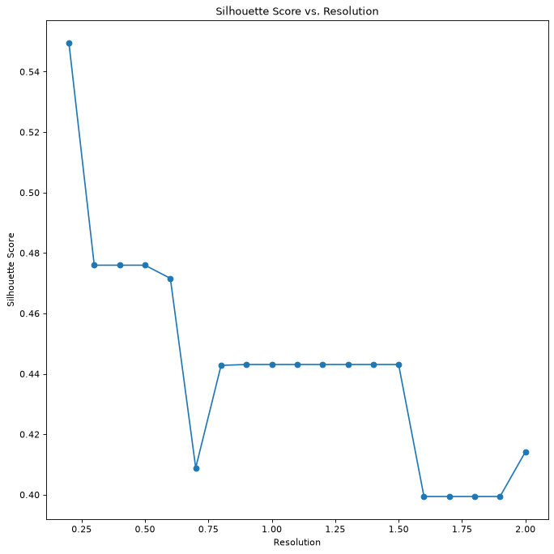

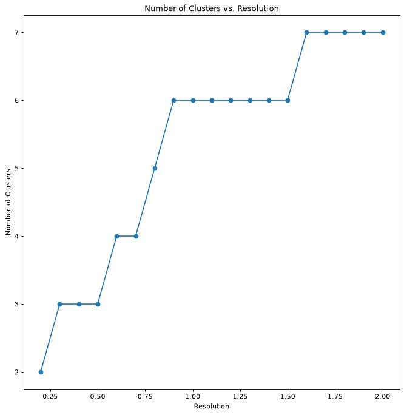

```python
proportion_df = pl.pl.clustering_emd(adata, res = adata.uns['best_res'], show_gene_labels = False, rename_clusters = True, save = True)
```

```
Cluster names (majority of 'disease'):
  1 -> acute kidney failure  (28 samples, 43% acute kidney failure)
  0 -> normal  (39 samples, 59% normal)
```

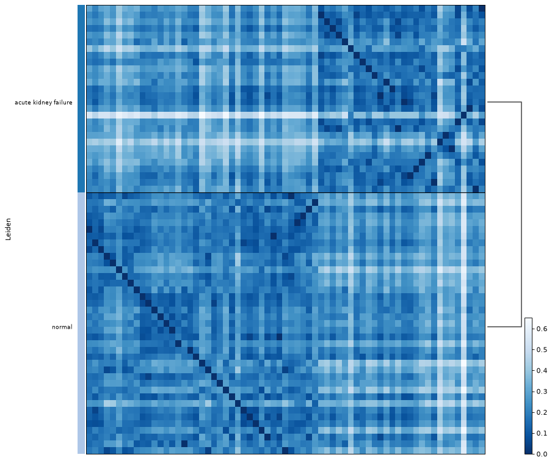

##### Evaluation of the association of estimated subgroups with experimental factor:
A very important question is if PILOT analysis is affected by experimental artefacts (location of tissues, batch processing). To evaluate this, PILOT tests the association between every variable describing the samples and the found clusters.
<div class="alert alert-block alert-info">
`pl.tl.correlation_with_clustering` checks **all** columns of `adata.obs` automatically, in the same way as `pl.tl.correlation_with_trajectory` (see the [trajectory tutorial](https://pilot.readthedocs.io/en/latest/Kidney_trajectory.html)): usable variables are kept, their type is detected and the others are skipped with a reason. Categorical variables are tested with a Chi-squared test, numeric variables with ANOVA (and Kruskal-Wallis) between the clusters. The result is one table with all variables, sorted by p-value.
</div>

```python
res = pl.tl.correlation_with_clustering(adata, proportion_df, sample_col = 'donor_id')
res
```

```
Tested 29 variables (13 categorical, 16 numeric); skipped 28 columns.
  skipped (differs between the cells of a sample (cell-level)): subclass.full, subclass.l3, subclass.l2, subclass.l1, state.l2, state, class, structure, ...
  skipped (only one value): assay, organism, organism_ontology_term_id, assay_ontology_term_id
  skipped (same groups as 'development_stage'): development_stage_ontology_term_id
  skipped (same groups as 'disease'): condition.l1, disease_ontology_term_id
  skipped (same groups as 'percent.cortex'): percent.medulla
  skipped (same groups as 'self_reported_ethnicity'): self_reported_ethnicity_ontology_term_id
  skipped (same groups as 'sex'): sex_ontology_term_id
  skipped (same groups as 'suspension_type'): id
  skipped (same groups as 'tissue'): tissue_ontology_term_id
  skipped (too many different values (67 for 67 samples, e.g. an ID)): library, experiment, specimen
  skipped (too many missing values (35 of 67)): region.l1, region.l2
  skipped (too many missing values (37 of 67)): BMI
```

<table border="1" class="dataframe">
  <thead>
    <tr style="text-align: right;">
      <th></th>
      <th>Feature</th>
      <th>Type</th>
      <th>Level</th>
      <th>Test</th>
      <th>Statistic</th>
      <th>P_value</th>
      <th>Adjusted_P_value</th>
      <th>Kruskal_P_value</th>
      <th>N_samples</th>
      <th>N_groups</th>
      <th>N_clusters</th>
      <th>Note</th>
    </tr>
  </thead>
  <tbody>
    <tr>
      <th>0</th>
      <td>percent.cortex</td>
      <td>numeric</td>
      <td>cell (mean)</td>
      <td>ANOVA</td>
      <td>32.636287</td>
      <td>0.000002</td>
      <td>0.000059</td>
      <td>0.000044</td>
      <td>36</td>
      <td>14</td>
      <td>2</td>
      <td></td>
    </tr>
    <tr>
      <th>1</th>
      <td>tissue</td>
      <td>categorical</td>
      <td>sample (most frequent)</td>
      <td>Chi-squared</td>
      <td>15.791104</td>
      <td>0.001251</td>
      <td>0.018146</td>
      <td>NaN</td>
      <td>67</td>
      <td>4</td>
      <td>2</td>
      <td></td>
    </tr>
    <tr>
      <th>2</th>
      <td>disease</td>
      <td>categorical</td>
      <td>sample</td>
      <td>Chi-squared</td>
      <td>9.052130</td>
      <td>0.010823</td>
      <td>0.058949</td>
      <td>NaN</td>
      <td>67</td>
      <td>3</td>
      <td>2</td>
      <td></td>
    </tr>
    <tr>
      <th>3</th>
      <td>nFeature_RNA</td>
      <td>numeric</td>
      <td>cell (mean)</td>
      <td>ANOVA</td>
      <td>6.842356</td>
      <td>0.011056</td>
      <td>0.058949</td>
      <td>0.024444</td>
      <td>67</td>
      <td>67</td>
      <td>2</td>
      <td></td>
    </tr>
    <tr>
      <th>4</th>
      <td>glycoprotein.score</td>
      <td>numeric</td>
      <td>cell (mean)</td>
      <td>ANOVA</td>
      <td>6.778272</td>
      <td>0.011421</td>
      <td>0.058949</td>
      <td>0.013656</td>
      <td>67</td>
      <td>67</td>
      <td>2</td>
      <td></td>
    </tr>
    <tr>
      <th>5</th>
      <td>condition.l2</td>
      <td>categorical</td>
      <td>sample</td>
      <td>Chi-squared</td>
      <td>12.296361</td>
      <td>0.015278</td>
      <td>0.058949</td>
      <td>NaN</td>
      <td>67</td>
      <td>5</td>
      <td>2</td>
      <td></td>
    </tr>
    <tr>
      <th>6</th>
      <td>condition.long</td>
      <td>categorical</td>
      <td>sample</td>
      <td>Chi-squared</td>
      <td>13.930142</td>
      <td>0.016059</td>
      <td>0.058949</td>
      <td>NaN</td>
      <td>67</td>
      <td>6</td>
      <td>2</td>
      <td></td>
    </tr>
    <tr>
      <th>7</th>
      <td>diabetes_history</td>
      <td>categorical</td>
      <td>sample</td>
      <td>Chi-squared</td>
      <td>5.774357</td>
      <td>0.016262</td>
      <td>0.058949</td>
      <td>NaN</td>
      <td>58</td>
      <td>2</td>
      <td>2</td>
      <td></td>
    </tr>
    <tr>
      <th>8</th>
      <td>nCount_RNA</td>
      <td>numeric</td>
      <td>cell (mean)</td>
      <td>ANOVA</td>
      <td>4.516414</td>
      <td>0.037377</td>
      <td>0.120437</td>
      <td>0.034837</td>
      <td>67</td>
      <td>67</td>
      <td>2</td>
      <td></td>
    </tr>
    <tr>
      <th>9</th>
      <td>percent.mt</td>
      <td>numeric</td>
      <td>cell (mean)</td>
      <td>ANOVA</td>
      <td>2.743956</td>
      <td>0.102443</td>
      <td>0.292408</td>
      <td>0.203646</td>
      <td>67</td>
      <td>67</td>
      <td>2</td>
      <td></td>
    </tr>
    <tr>
      <th>10</th>
      <td>matrisome.score</td>
      <td>numeric</td>
      <td>cell (mean)</td>
      <td>ANOVA</td>
      <td>2.597864</td>
      <td>0.111853</td>
      <td>0.292408</td>
      <td>0.133600</td>
      <td>67</td>
      <td>67</td>
      <td>2</td>
      <td></td>
    </tr>
    <tr>
      <th>11</th>
      <td>sex</td>
      <td>categorical</td>
      <td>sample</td>
      <td>Chi-squared</td>
      <td>2.404375</td>
      <td>0.120996</td>
      <td>0.292408</td>
      <td>NaN</td>
      <td>67</td>
      <td>2</td>
      <td>2</td>
      <td></td>
    </tr>
    <tr>
      <th>12</th>
      <td>proteoglycan.score</td>
      <td>numeric</td>
      <td>cell (mean)</td>
      <td>ANOVA</td>
      <td>2.251728</td>
      <td>0.138307</td>
      <td>0.308532</td>
      <td>0.154510</td>
      <td>67</td>
      <td>67</td>
      <td>2</td>
      <td></td>
    </tr>
    <tr>
      <th>13</th>
      <td>aEpi.score</td>
      <td>numeric</td>
      <td>cell (mean)</td>
      <td>ANOVA</td>
      <td>1.266560</td>
      <td>0.264551</td>
      <td>0.525399</td>
      <td>0.147280</td>
      <td>67</td>
      <td>67</td>
      <td>2</td>
      <td></td>
    </tr>
    <tr>
      <th>14</th>
      <td>tissue_type</td>
      <td>categorical</td>
      <td>sample</td>
      <td>Chi-squared</td>
      <td>2.401622</td>
      <td>0.300950</td>
      <td>0.525399</td>
      <td>NaN</td>
      <td>67</td>
      <td>3</td>
      <td>2</td>
      <td></td>
    </tr>
    <tr>
      <th>15</th>
      <td>development_stage</td>
      <td>categorical</td>
      <td>sample</td>
      <td>Chi-squared</td>
      <td>11.745483</td>
      <td>0.302452</td>
      <td>0.525399</td>
      <td>NaN</td>
      <td>45</td>
      <td>11</td>
      <td>2</td>
      <td>22 group(s) with &lt; 2 samples not tested</td>
    </tr>
    <tr>
      <th>16</th>
      <td>G2M.Score</td>
      <td>numeric</td>
      <td>cell (mean)</td>
      <td>ANOVA</td>
      <td>0.980226</td>
      <td>0.325814</td>
      <td>0.525399</td>
      <td>0.387347</td>
      <td>67</td>
      <td>67</td>
      <td>2</td>
      <td></td>
    </tr>
    <tr>
      <th>17</th>
      <td>self_reported_ethnicity</td>
      <td>categorical</td>
      <td>sample</td>
      <td>Chi-squared</td>
      <td>0.964286</td>
      <td>0.326109</td>
      <td>0.525399</td>
      <td>NaN</td>
      <td>60</td>
      <td>2</td>
      <td>2</td>
      <td>2 group(s) with &lt; 2 samples not tested</td>
    </tr>
    <tr>
      <th>18</th>
      <td>S.Score</td>
      <td>numeric</td>
      <td>cell (mean)</td>
      <td>ANOVA</td>
      <td>0.686838</td>
      <td>0.410275</td>
      <td>0.619274</td>
      <td>0.430601</td>
      <td>67</td>
      <td>67</td>
      <td>2</td>
      <td></td>
    </tr>
    <tr>
      <th>19</th>
      <td>hypertension</td>
      <td>categorical</td>
      <td>sample</td>
      <td>Chi-squared</td>
      <td>0.509206</td>
      <td>0.475483</td>
      <td>0.619274</td>
      <td>NaN</td>
      <td>59</td>
      <td>2</td>
      <td>2</td>
      <td></td>
    </tr>
    <tr>
      <th>20</th>
      <td>aStr.score</td>
      <td>numeric</td>
      <td>cell (mean)</td>
      <td>ANOVA</td>
      <td>0.505586</td>
      <td>0.479600</td>
      <td>0.619274</td>
      <td>0.423203</td>
      <td>67</td>
      <td>67</td>
      <td>2</td>
      <td></td>
    </tr>
    <tr>
      <th>21</th>
      <td>degen.score</td>
      <td>numeric</td>
      <td>cell (mean)</td>
      <td>ANOVA</td>
      <td>0.465439</td>
      <td>0.497517</td>
      <td>0.619274</td>
      <td>0.693521</td>
      <td>67</td>
      <td>67</td>
      <td>2</td>
      <td></td>
    </tr>
    <tr>
      <th>22</th>
      <td>pagoda_k100_infomap_coembed</td>
      <td>numeric</td>
      <td>cell (mean)</td>
      <td>ANOVA</td>
      <td>0.443269</td>
      <td>0.507905</td>
      <td>0.619274</td>
      <td>0.684159</td>
      <td>67</td>
      <td>67</td>
      <td>2</td>
      <td></td>
    </tr>
    <tr>
      <th>23</th>
      <td>percent.er</td>
      <td>numeric</td>
      <td>cell (mean)</td>
      <td>ANOVA</td>
      <td>0.433706</td>
      <td>0.512502</td>
      <td>0.619274</td>
      <td>0.674846</td>
      <td>67</td>
      <td>67</td>
      <td>2</td>
      <td></td>
    </tr>
    <tr>
      <th>24</th>
      <td>suspension_type</td>
      <td>categorical</td>
      <td>sample (most frequent)</td>
      <td>Chi-squared</td>
      <td>0.312268</td>
      <td>0.576292</td>
      <td>0.667653</td>
      <td>NaN</td>
      <td>67</td>
      <td>2</td>
      <td>2</td>
      <td></td>
    </tr>
    <tr>
      <th>25</th>
      <td>collagen.score</td>
      <td>numeric</td>
      <td>cell (mean)</td>
      <td>ANOVA</td>
      <td>0.262735</td>
      <td>0.609985</td>
      <td>0.667653</td>
      <td>0.468696</td>
      <td>67</td>
      <td>67</td>
      <td>2</td>
      <td></td>
    </tr>
    <tr>
      <th>26</th>
      <td>is_primary_data</td>
      <td>categorical</td>
      <td>sample</td>
      <td>Chi-squared</td>
      <td>0.216533</td>
      <td>0.641694</td>
      <td>0.667653</td>
      <td>NaN</td>
      <td>67</td>
      <td>2</td>
      <td>2</td>
      <td></td>
    </tr>
    <tr>
      <th>27</th>
      <td>cyc.score</td>
      <td>numeric</td>
      <td>cell (mean)</td>
      <td>ANOVA</td>
      <td>0.214734</td>
      <td>0.644630</td>
      <td>0.667653</td>
      <td>0.789501</td>
      <td>67</td>
      <td>67</td>
      <td>2</td>
      <td></td>
    </tr>
    <tr>
      <th>28</th>
      <td>eGFR</td>
      <td>categorical</td>
      <td>sample</td>
      <td>Chi-squared</td>
      <td>1.059432</td>
      <td>0.900654</td>
      <td>0.900654</td>
      <td>NaN</td>
      <td>60</td>
      <td>5</td>
      <td>2</td>
      <td></td>
    </tr>
  </tbody>
</table>

<div class="alert alert-block alert-info">
`pl.pl.cluster_associations` shows the significant variables: for a categorical variable the fraction of each group in each cluster, for a numeric variable its values per cluster (box plot).

The functions of earlier versions still work: `pl.tl.correlation_categorical_with_clustering` and `pl.tl.correlation_numeric_with_clustering`, with your own list of variables.
</div>

```python
pl.pl.cluster_associations(adata)
```

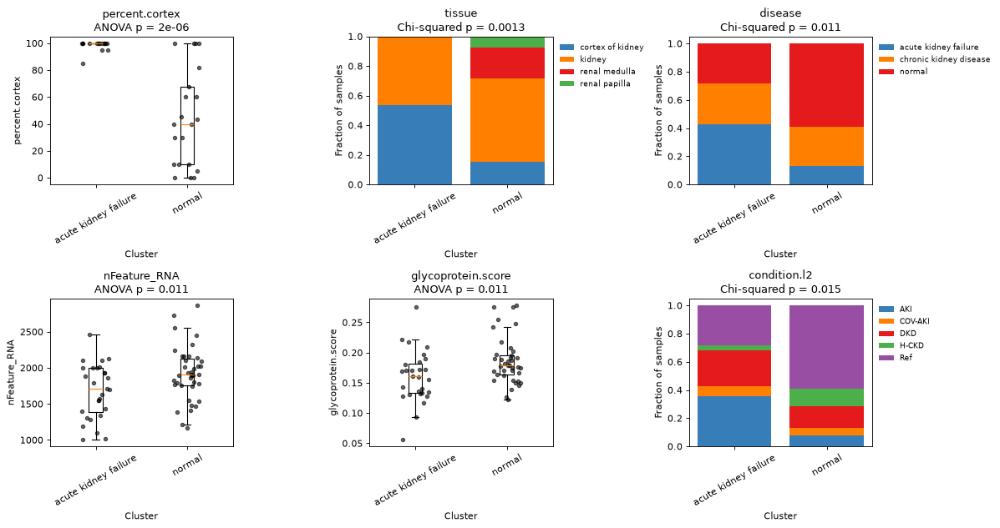

We observe that there is a clear association between the sub-clusters and the origin of the biopsies. This is not surprising as PILOT uses cellular composition information, as samples at distinct regions do have distinct cells.

To double check these results, one can of course plot the heatmap of clusters by showing the variables with 'clinical_variables_corr_sub_clusters' function. `order` sets the order of the clusters.

```python
order = sorted(proportion_df['Predicted_Labels'].unique())
```

###### Disease

```python
pl.tl.clinical_variables_corr_sub_clusters(adata,sorter_order=order,sample_col='donor_id',feature='disease',proportion_df=proportion_df,figsize_legend=(1,1))
```

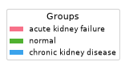

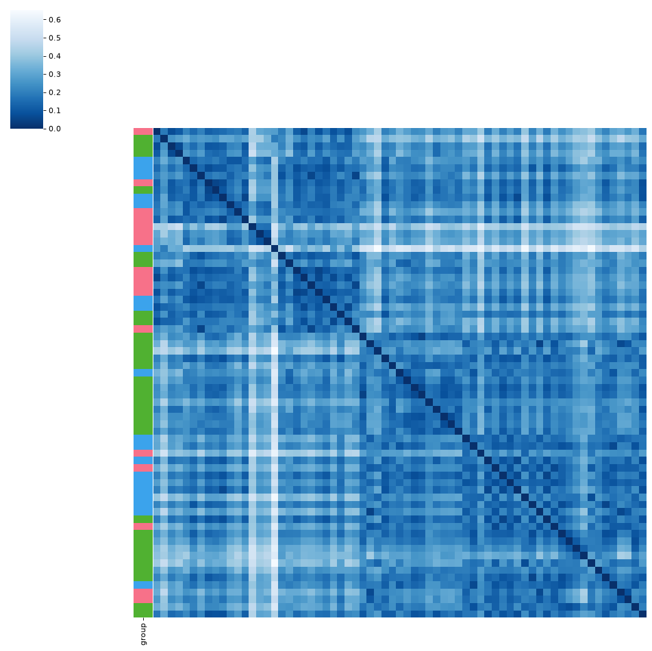

###### Tissue

```python
pl.tl.clinical_variables_corr_sub_clusters(adata,sorter_order=order,sample_col='donor_id',feature='tissue',proportion_df=proportion_df,figsize_legend=(1,1))
```

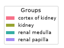

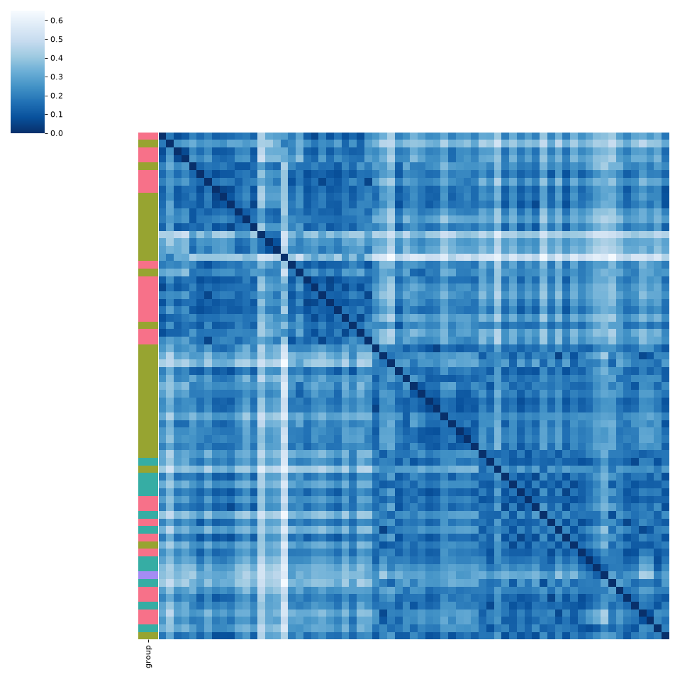

###### BMI

```python
pl.tl.clinical_variables_corr_sub_clusters(adata,sorter_order=order,sample_col='donor_id',feature='BMI',proportion_df=proportion_df,figsize_legend=(1,1))
```

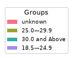

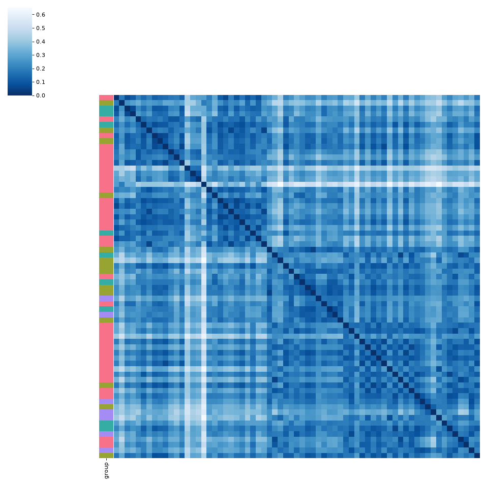

#### Filtering of samples

Therefore, we only focus on biopsies from sample locationn 'kidney', which were used in our benchmarking. You can download the Anndata (h5ad) file from [here](https://costalab.ukaachen.de/open_data/PILOT/Kidney_filtered.h5ad), and place it in the _Datasets_ folder.


```python
adata_filtered=sc.read_h5ad('/Datasets/Kidney.h5ad')
```


```python
pl.tl.wasserstein_distance(
    adata_filtered,
    emb_matrix = 'X_pca',
    clusters_col = 'cell_type',
    sample_col = 'donor_id',
    status = 'disease'
    )
```

Run the same functions for the filtered data.


```python
pl.pl.select_best_sil(adata_filtered, start = 0.3)
```


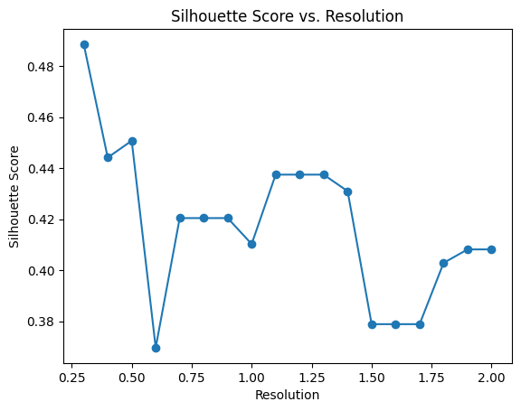


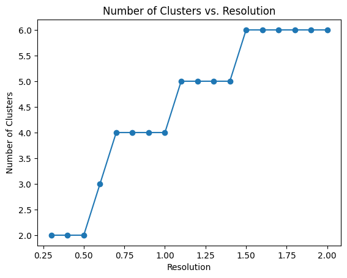


```python
proportion_df=pl.pl.clustering_emd(adata_filtered, res = adata_filtered.uns['best_res'],show_gene_labels=False,sorter_leiden=['0','1'],save=True)
```


We next recheck the association of variables with the estimated sub-clusters. 


```python
pl.tl.correlation_categorical_with_clustering(adata_filtered,proportion_df,sample_col= 'donor_id', features = categorical)
```


<div>
<style scoped>
    .dataframe tbody tr th:only-of-type {
        vertical-align: middle;
    }

    .dataframe tbody tr th {
        vertical-align: top;
    }

    .dataframe thead th {
        text-align: right;
    }
</style>
<table border="1" class="dataframe">
  <thead>
    <tr style="text-align: right;">
      <th></th>
      <th>Feature</th>
      <th>ChiSquared_Statistic</th>
      <th>ChiSquared_PValue</th>
    </tr>
  </thead>
  <tbody>
    <tr>
      <th>6</th>
      <td>disease</td>
      <td>17.488757</td>
      <td>0.000159</td>
    </tr>
    <tr>
      <th>5</th>
      <td>diabetes_history</td>
      <td>6.784615</td>
      <td>0.009195</td>
    </tr>
    <tr>
      <th>0</th>
      <td>BMI</td>
      <td>7.857195</td>
      <td>0.049057</td>
    </tr>
  </tbody>
</table>
</div>


In the data we observed that the true label (disease) has the highest association followed by Diabetes History and BMI.

We can show the distribution of variables in the found clusters:

##### Disease


```python
meta=adata_filtered.obs[['diabetes_history','BMI','donor_id','disease']]
meta = meta.drop_duplicates(subset='donor_id').rename(columns={'donor_id': 'sampleID'})
proportion=proportion_df[['Predicted_Labels','sampleID']].merge(meta,on='sampleID')
contingency_table = pd.crosstab(proportion['disease'], proportion['Predicted_Labels'],values=proportion['sampleID'], aggfunc=pd.Series.nunique, margins=True, margins_name='Total Unique Patients')
# Display the contingency table
contingency_table
```


<div>
<style scoped>
    .dataframe tbody tr th:only-of-type {
        vertical-align: middle;
    }

    .dataframe tbody tr th {
        vertical-align: top;
    }

    .dataframe thead th {
        text-align: right;
    }
</style>
<table border="1" class="dataframe">
  <thead>
    <tr style="text-align: right;">
      <th>Predicted_Labels</th>
      <th>0</th>
      <th>1</th>
      <th>Total Unique Patients</th>
    </tr>
    <tr>
      <th>disease</th>
      <th></th>
      <th></th>
      <th></th>
    </tr>
  </thead>
  <tbody>
    <tr>
      <th>Normal</th>
      <td>17.0</td>
      <td>1.0</td>
      <td>18</td>
    </tr>
    <tr>
      <th>acute kidney failure</th>
      <td>NaN</td>
      <td>5.0</td>
      <td>5</td>
    </tr>
    <tr>
      <th>chronic kidney disease</th>
      <td>9.0</td>
      <td>4.0</td>
      <td>13</td>
    </tr>
    <tr>
      <th>Total Unique Patients</th>
      <td>26.0</td>
      <td>10.0</td>
      <td>36</td>
    </tr>
  </tbody>
</table>
</div>


```python

```

##### BMI


```python

contingency_table = pd.crosstab(proportion['BMI'], proportion['Predicted_Labels'],values=proportion['sampleID'], aggfunc=pd.Series.nunique, margins=True, margins_name='Total Unique Patients')
contingency_table
```


<div>
<style scoped>
    .dataframe tbody tr th:only-of-type {
        vertical-align: middle;
    }

    .dataframe tbody tr th {
        vertical-align: top;
    }

    .dataframe thead th {
        text-align: right;
    }
</style>
<table border="1" class="dataframe">
  <thead>
    <tr style="text-align: right;">
      <th>Predicted_Labels</th>
      <th>0</th>
      <th>1</th>
      <th>Total Unique Patients</th>
    </tr>
    <tr>
      <th>BMI</th>
      <th></th>
      <th></th>
      <th></th>
    </tr>
  </thead>
  <tbody>
    <tr>
      <th>18.5—24.9</th>
      <td>2.0</td>
      <td>NaN</td>
      <td>2</td>
    </tr>
    <tr>
      <th>25.0—29.9</th>
      <td>10.0</td>
      <td>1.0</td>
      <td>11</td>
    </tr>
    <tr>
      <th>30.0 and Above</th>
      <td>4.0</td>
      <td>NaN</td>
      <td>4</td>
    </tr>
    <tr>
      <th>unknown</th>
      <td>10.0</td>
      <td>9.0</td>
      <td>19</td>
    </tr>
    <tr>
      <th>Total Unique Patients</th>
      <td>26.0</td>
      <td>10.0</td>
      <td>36</td>
    </tr>
  </tbody>
</table>
</div>


```python

```

##### Diabetes history


```python
contingency_table = pd.crosstab(proportion['diabetes_history'], proportion['Predicted_Labels'],values=proportion['sampleID'], aggfunc=pd.Series.nunique, margins=True, margins_name='Total Unique Patients')
# Display the contingency table
contingency_table
```


<div>
<style scoped>
    .dataframe tbody tr th:only-of-type {
        vertical-align: middle;
    }

    .dataframe tbody tr th {
        vertical-align: top;
    }

    .dataframe thead th {
        text-align: right;
    }
</style>
<table border="1" class="dataframe">
  <thead>
    <tr style="text-align: right;">
      <th>Predicted_Labels</th>
      <th>0</th>
      <th>1</th>
      <th>Total Unique Patients</th>
    </tr>
    <tr>
      <th>diabetes_history</th>
      <th></th>
      <th></th>
      <th></th>
    </tr>
  </thead>
  <tbody>
    <tr>
      <th>No</th>
      <td>17</td>
      <td>1</td>
      <td>18</td>
    </tr>
    <tr>
      <th>Yes</th>
      <td>9</td>
      <td>9</td>
      <td>18</td>
    </tr>
    <tr>
      <th>Total Unique Patients</th>
      <td>26</td>
      <td>10</td>
      <td>36</td>
    </tr>
  </tbody>
</table>
</div>


To double check these results, one can of course plot the heatmap of clusters by showing the variables with 'clinical_variables_corr_sub_clusters' function. 


###### Disease


```python
pl.tl.clinical_variables_corr_sub_clusters(adata_filtered, sorter_order=['0','1'],sample_col='donor_id',feature= 'disease',proportion_df = proportion_df,figsize_legend=(1,1))
```


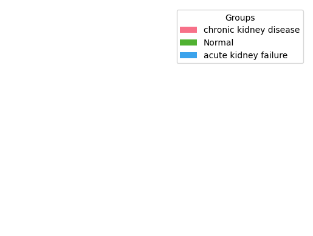


###### BMI


```python
pl.tl.clinical_variables_corr_sub_clusters(adata_filtered, sorter_order = ['0','1'],sample_col = 'donor_id',feature = 'BMI',proportion_df = proportion_df,figsize_legend=(1,1))
```


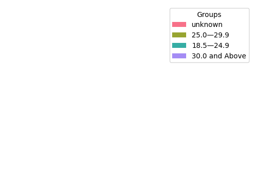


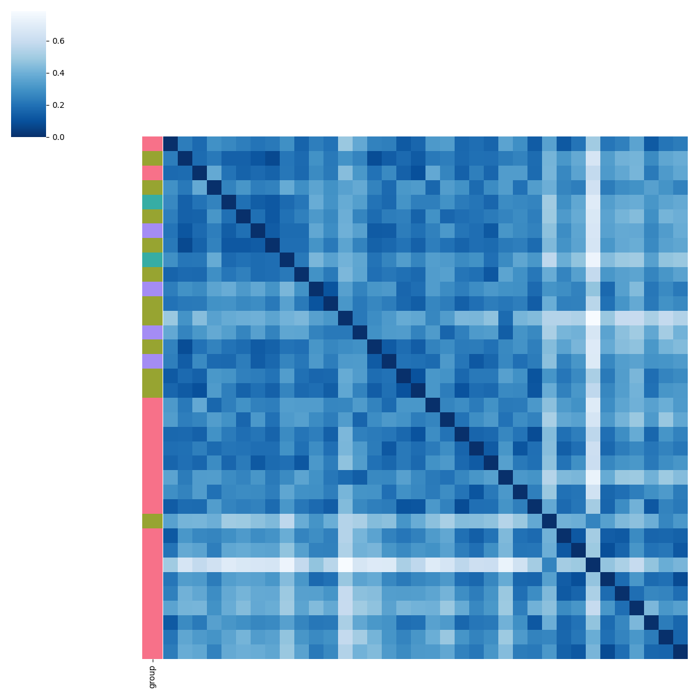


###### Diabetes_history


```python
pl.tl.clinical_variables_corr_sub_clusters(adata_filtered, sorter_order = ['0','1'],sample_col = 'donor_id',feature = 'diabetes_history',proportion_df = proportion_df,figsize_legend=(1,1))
```


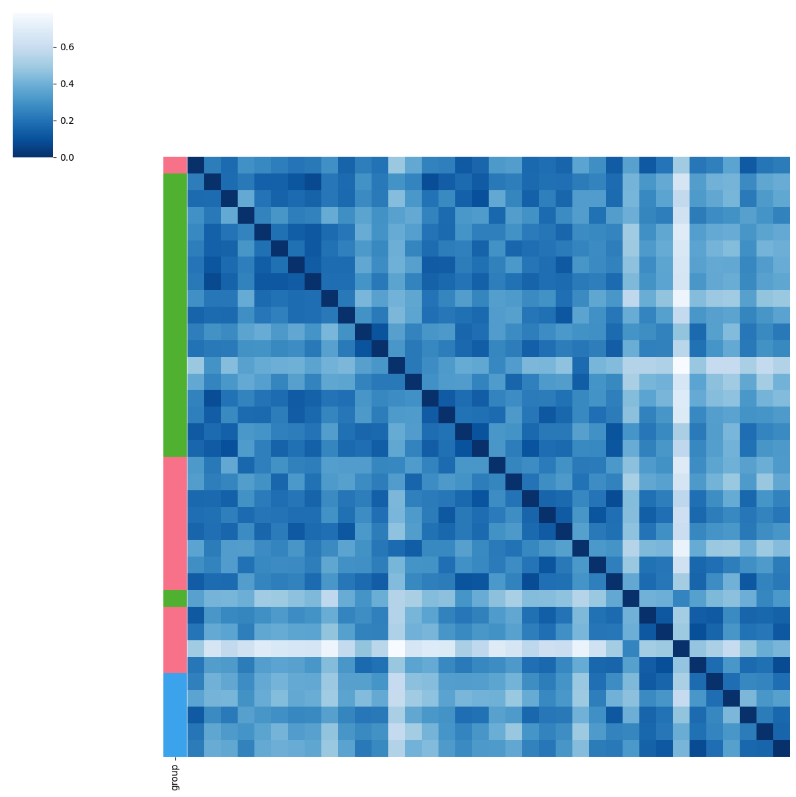

